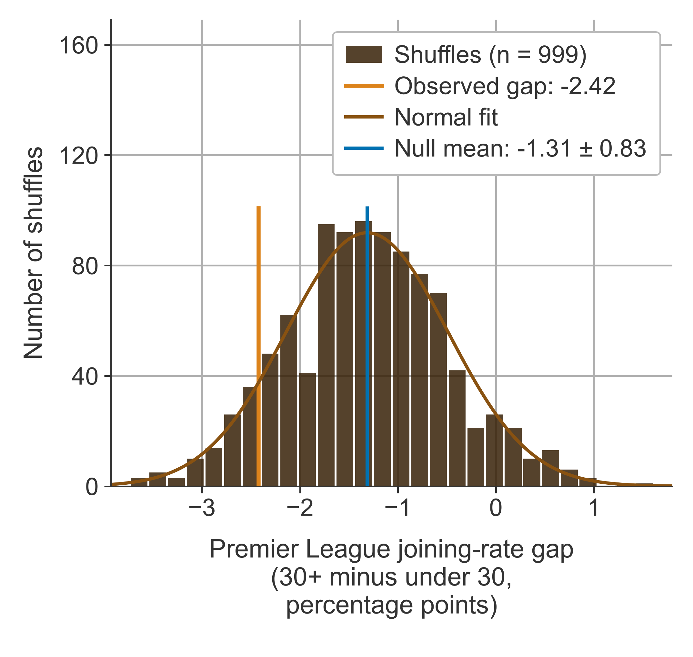

# Age and Premier League entry: restricted-period permutation analysis

Recorded source seasons 2012/13–2024/25 include 16,636 eligible transfers involving 4,602 players, dated 1 July 2012–15 July 2025. This is a source-season restriction, not an exact July–June date cutoff. Other eligibility rules are unchanged. Both endpoints use season-specific Premier League membership (GB1).

Joining rates divide Premier League arrivals by all eligible transfers within each age group. The statistic is 100 × (rate_30_plus − rate_under_30), in percentage points. Seed 2026 supplies the same three SeedSequence child streams for main shuffles, player selection and sensitivity shuffles. The 999 within-origin-club/season age-label permutations hold destinations and stratum age counts fixed. The lower-tail p value includes ties and uses (1 + tail count) / 1000.

The sensitivity sample is a new uniform draw of one eligible transfer for each of the 4,602 players in the restricted input. This draw remains fixed across permutations; membership is saved in ../provenance/h1_sensitivity_selected_rows.csv.

| Analysis | Under-30 arrivals / transfers (%) | 30+ arrivals / transfers (%) | Observed gap (pp) | Null mean (pp) | One-sided p |
| --- | ---: | ---: | ---: | ---: | ---: |
| All eligible transfers | 2,267 / 15,573 (14.56) | 129 / 1,063 (12.14) | -2.42 | -1.31 | 0.098 |
| One transfer per player | 925 / 4,310 (21.46) | 57 / 292 (19.52) | -1.94 | 0.46 | 0.074 |

Both observed gaps are negative. The one-sided permutation p values are 0.098 and 0.074; neither falls below 0.05. The null expectation need not be zero because age groups differ in origin club–season composition. Repeated players can undermine exchangeability in the main analysis. The sensitivity is conditional on one fixed draw, not an independent replication. These results describe recorded transfers and do not establish a causal age effect or exhaustive transfer histories.

[Publication exports and captions](age_shuffle_outsideprem_toprem_findings/README.md). [Saved results](age_shuffle_outsideprem_toprem_results.json). The JSON snapshot_verification compares with historical broad-period counts and is expected to differ; it is not restricted-sample validation. Restricted validation is saved in ../provenance/h1_verification.json.
