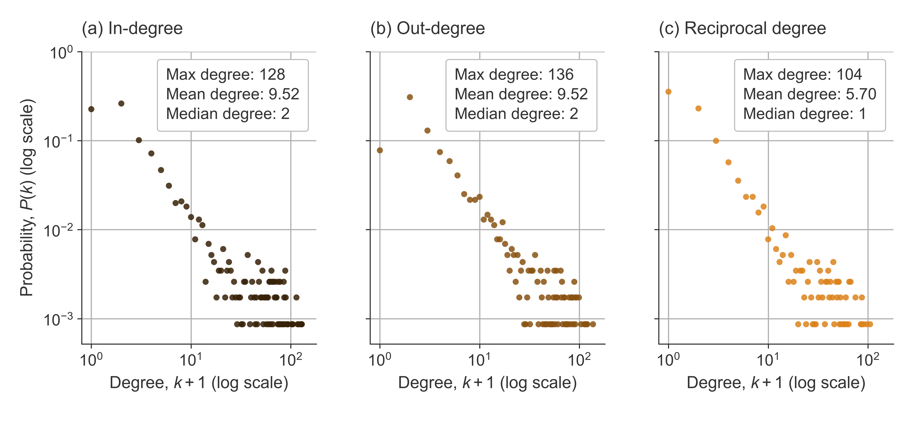

# Club transfer degree distributions

The [executed notebook](../notebooks/exploration_v3.ipynb) groups the [16,636 eligible transfer records](../data/outsideprem_toprem_eligible_transfers.csv.gz) from recorded seasons 2012/13–2024/25 into 11,016 directed routes among 1,157 clubs. A route joins an origin to a destination, and its weight counts the recorded transfers along that route. The graph has no self-loops. Route weights and all per-club degrees were checked against the [shared observed graph](transfer_community_comparison/observed_routes.csv).

For each club, in-degree counts distinct origins, out-degree counts distinct destinations, and reciprocal degree counts clubs in both sets. The notebook divides the count at each exact degree by 1,157. Both axes are logarithmic, with degree plotted at `k + 1` so degree zero appears at 1.

| Statistic | In-degree | Out-degree | Reciprocal degree |
| --- | ---: | ---: | ---: |
| Mean | 9.52 | 9.52 | 5.70 |
| Median | 2 | 2 | 1 |
| Maximum | 128 | 136 | 104 |
| Clubs with degree zero | 261 | 90 | 410 |
| Clubs with degree one | 302 | 356 | 266 |

Genoa has the highest in-degree. Inter has the highest out-degree and reciprocal degree. Each route contributes one incoming connection and one outgoing connection, so the network means for those measures are equal.

The distributions have many low-degree clubs and a smaller tail of clubs with many partners. For example, the in-degree point at `k + 1 = 2` represents 302 clubs, or 26.1% of the sample. A point at probability `1 / 1,157` represents a single club. Each dot therefore needs to be read by its height. The figure uses exact-degree frequencies with no bins or fitted distribution, so its shape alone cannot establish a power law.

[Per-club degrees](club_transfer_network_findings/club_degrees.csv) · [Network summary](club_transfer_network_findings/network_summary.csv) · [Figures and reproduction](club_transfer_network_findings/README.md)
