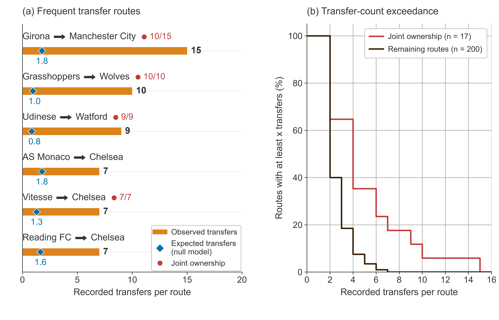
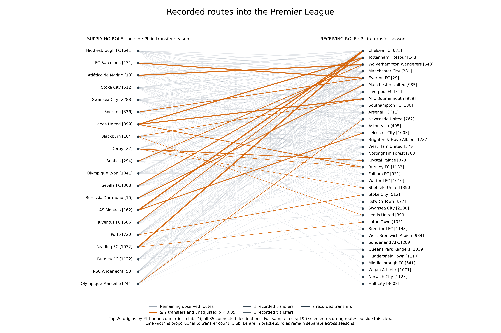
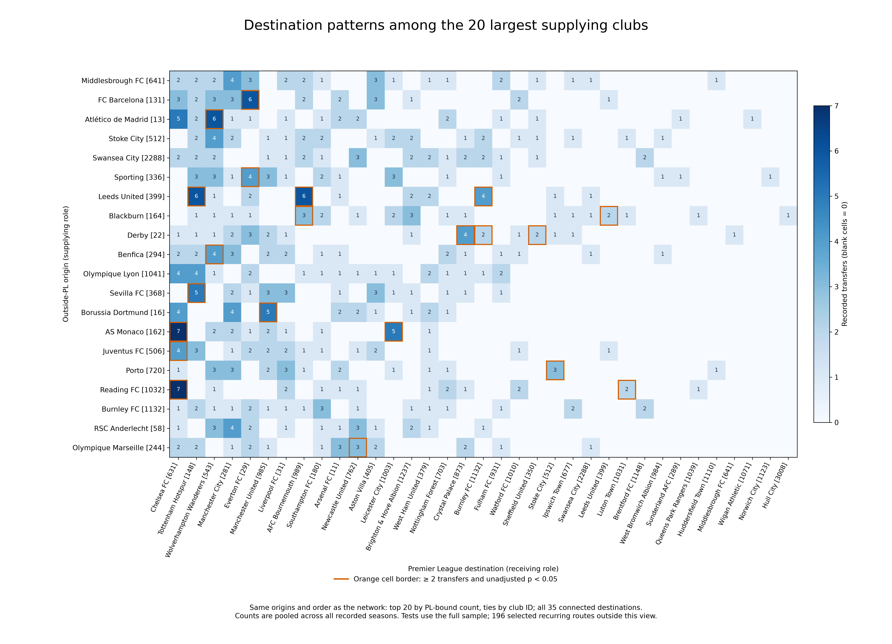

# Recorded feeder routes into the Premier League

The sample contains **2,396 Premier League arrivals** from 450 supplying clubs to 37 receiving clubs, selected from 16,636 input records. Both endpoints use Premier League membership (`GB1`) in the recorded transfer season. Non-club IDs 515 (Without Club), 123 (Retired), and 2113 (Career break) are excluded. Supplying and receiving roles are separate nodes even when a club occupies both across seasons.

Exclusions, applied sequentially: 0 non-club origins; 0 non-club destinations; 0 PL origins; 14,240 non-PL destinations. Snapshot discrepancies: {"input_transfer_records": {"expected": 19712, "observed": 16636}, "premier_league_arrival_records": {"expected": 2882, "observed": 2396}}.

## Methods

Route counts are pooled across seasons. Each expected count is the sum over seasons of `origin_PL_arrivals * destination_arrivals / total_PL_arrivals`. Destination share is the route count divided by the origin's PL-bound total: it describes destination choice conditional on entering the PL, rather than the origin's overall PL joining rate. Counts accompany shares because one transfer can yield 100%.

We shuffled destination IDs within each season 999 times using NumPy default_rng, seed 2026, after sorting by season, origin ID, destination ID, player ID, and date. Every draw preserves both origin and destination totals in every season. The upper-tail Monte Carlo p-value is `(1 + count(shuffled_count >= observed_count)) / (1 + permutations)`, including ties. Its minimum and grid spacing are 0.001. We tested **all 11,448 pairs with positive expected count**, including 9,764 unobserved routes (p = 1). The significance flag uses unadjusted p < 0.05. Selected routes must also have at least two recorded transfers; highlighting uses both criteria. This recurrence requirement is a design choice to focus on repeated movement, not an additional statistical test. It counts recorded events, not necessarily distinct players or permanent sales. The shuffle uses the full arrival sample before this route filter is applied. No multiple-comparison correction is applied; this is a per-route threshold and does not control false discoveries across all tested routes. A minimum-grid p-value is not zero.

## Results

**217 recurring routes are selected: at least 2 recorded transfers and unadjusted p < 0.05.**

296 routes pass the statistical threshold alone; 79 single-transfer routes are excluded by the recurrence requirement. The selected routes contain 626 recorded transfers.

The smallest unadjusted p-value is 0.001; 23 routes reach the minimum Monte Carlo p-value. The finite resolution limits distinctions between routes with small tail probabilities.

The table below lists selected recurring routes ranked by unadjusted p, then count (ID tie breaks). Every route meets both the statistical and recurrence criteria.

| Origin → destination (IDs) | Transfers | Expected | Obs./exp. | Origin PL total | Share | Distinct players | Repeat extras | Unadjusted p |
| --- | ---: | ---: | ---: | ---: | ---: | ---: | ---: | ---: |
| Girona FC [12321] → Manchester City [281] | 15 | 1.774 | 8.46 | 19 | 78.9% | 12 | 3 | 0.001 |
| Grasshoppers [504] → Wolverhampton Wanderers [543] | 10 | 0.953 | 10.49 | 10 | 100.0% | 9 | 1 | 0.001 |
| Udinese Calcio [410] → Watford FC [1010] | 9 | 0.846 | 10.64 | 15 | 60.0% | 8 | 1 | 0.001 |
| Vitesse [499] → Chelsea FC [631] | 7 | 1.288 | 5.44 | 10 | 70.0% | 7 | 0 | 0.001 |
| Olympiacos [683] → Nottingham Forest [703] | 6 | 0.787 | 7.62 | 15 | 40.0% | 6 | 0 | 0.001 |
| Union SG [3948] → Brighton & Hove Albion [1237] | 6 | 0.464 | 12.93 | 6 | 100.0% | 5 | 1 | 0.001 |
| Borussia Dortmund [16] → Manchester United [985] | 5 | 0.824 | 6.07 | 22 | 22.7% | 4 | 1 | 0.001 |
| Famalicão [3329] → Wolverhampton Wanderers [543] | 5 | 0.486 | 10.29 | 5 | 100.0% | 5 | 0 | 0.001 |
| River Plate [209] → Manchester City [281] | 4 | 0.336 | 11.91 | 5 | 80.0% | 2 | 2 | 0.001 |
| ESTAC Troyes [1095] → Manchester City [281] | 4 | 0.488 | 8.19 | 8 | 50.0% | 4 | 0 | 0.001 |

Among observed routes, 157 have more transfers than distinct players; there are 168 extra route records beyond one per player per route. The ten displayed candidates contain 6 flagged routes. This flags repeated player involvement, not necessarily duplicate events, and is a descriptive check, not an independent significance test. The route table includes distinct players, repeat extras, and a flag for every pair. There are 0 completely identical arrival rows.

## Two-panel feeder findings

The restricted recorded seasons are 2012/13–2024/25, with actual eligible-input dates 1 July 2012–15 July 2025. Coverage is not certified exhaustive. There are 2,396 recorded PL arrivals from 450 supplying clubs to 37 receiving clubs (1,257 distinct players). These are separate from the Guardian samples. Counts include repeat players, loans and returns. The source-season convention and original eligibility rules are retained.

Destinations are reassigned within each season, preserving seasonal origin and destination margins. Seed 2026 and 999 shuffles are unchanged. Expected counts sum origin-arrivals × destination-arrivals / all-arrivals over seasons. The upper-tail Monte Carlo p value includes ties and uses (1 + tail) / 1000. All 11,448 positive-expectation pairs are tested, including unobserved pairs. No multiplicity correction is applied. Of 296 pairs with unadjusted p<0.05, 217 have at least two recorded moves and contain 626 records.

Panel (a) displays all 6 selected routes with observed count ≥7, with ties retained and descending counts/club-ID ordering. Orange bars give observed counts and blue diamonds give expected counts, labelled to one decimal. Panel (b) uses the full selected sample.

| Route | Observed | Expected | Ownership annotation |
| --- | ---: | ---: | --- |
| Girona FC → Manchester City | 15 | 1.8 | 10/15 verified interval overlap |
| Grasshoppers → Wolverhampton Wanderers | 10 | 1.0 | 10/10 manual inclusion coverage; interval unverified |
| Udinese Calcio → Watford FC | 9 | 0.8 | 9/9 verified interval overlap |
| AS Monaco → Chelsea FC | 7 | 1.8 | No documented shared-equity annotation; absence is not proven independence |
| Vitesse → Chelsea FC | 7 | 1.3 | 7/7 manual inclusion coverage; interval unverified |
| Reading FC → Chelsea FC | 7 | 1.6 | No documented shared-equity annotation; absence is not proven independence |

Shared ownership means a documented common direct or indirect club-equity investor, including minority holdings. Source intervals are start-inclusive and exit-exclusive. Red dots mark the existing joint-ownership group. Verified fractions count event-date overlaps; manual fractions indicate inclusion coverage and are not verified ownership-period counts. The two authorised manual pairs remain:

- Grasshoppers → Wolverhampton Wanderers: 10 pooled records; equity interval remains unverified.
- Vitesse → Chelsea FC: 7 pooled records; equity interval remains unverified.

The bounded source screen covers 217 of 217 selected routes, including 28 additional routes reviewed for this rerun. The coverage ledger records the status of each route. The scoped evidence omits the historical Hearts/Liverpool interval because it predates the restricted period. Historical minority and beneficial-owner disclosures remain incomplete, so documented counts are a confirmed minimum. [Coverage ledger](../provenance/ownership_coverage_ledger.csv) · [Additional route screen](../provenance/ownership_screen_28_routes.md)

Panel (b) gives 100 × the fraction of each entire group with at least each integer transfer count, using inclusive pre-step curves. There is no binning, smoothing, jitter or fitted distribution. The red group contains 17 routes and the dark-brown remaining group 200. Curves use all 217 selected observations and end at zero one count above the observed maximum. Means and medians describe pooled route counts, not ownership-period transfer counts.

| Group | Routes | Pooled records | Mean | Median |
| --- | ---: | ---: | ---: | ---: |
| Joint ownership | 17 | 85 | 5.000000 | 4 |
| Remaining routes | 200 | 541 | 2.705000 | 2 |

Of 85 pooled records in the joint group, 62 have verified event-date ownership overlap. This descriptive comparison concerns the selected recurring routes. Estimating an ownership effect or network-wide overrepresentation would require further evidence.

[Ownership evidence](premier_league_feeder_ownership_evidence.json), [route audit](premier_league_feeder_ownership_audit.csv), [event flags](premier_league_feeder_ownership_events.csv), [ownership results](premier_league_feeder_ownership_results.json).

[PDF](premier_league_feeder_findings_three_panel.pdf), [SVG](premier_league_feeder_findings_three_panel.svg), [caption](premier_league_feeder_findings_three_panel_caption.md), [combined and standalone exports](premier_league_feeder_findings/README.md).

## Figures

Top 20 origins by PL-bound transfer count, ties by club ID; all connected destinations. Both figures use the same origin order and connected destinations; all routes remain in the statistical testing family. 196 selected recurring routes fall outside this view.

*Line width is proportional to recorded transfer count. Orange routes have at least 2 transfers and unadjusted p < 0.05; grey routes do not meet both criteria. Club IDs appear in brackets. The top-20-origin display is a subset of the full analysis.*

*The heatmap shows counts for the same top 20 origins and all their connected destinations. Blank cells have zero transfers; orange borders identify routes with at least 2 transfers and unadjusted p < 0.05.*

[Complete route table](premier_league_feeder_routes.csv) · [Selected recurring routes](premier_league_feeder_selected_routes.csv) · [Statistical threshold alone](premier_league_feeder_significant_routes.csv) · [Results and verification](premier_league_feeder_results.json)

## Season coverage and limitations

The analysis retains recorded seasons 2012/13–2024/25, including seasons with sparse or partial coverage. The dates below describe recorded events. The selected seasons follow source labels, and the eligible input includes events through 15 July 2025. The date spans cannot establish complete season coverage.

| Season | Input records | PL arrivals | PL lookup clubs | Input date range |
| --- | ---: | ---: | ---: | --- |
| 12/13 | 362 | 71 | 20 | 2012-07-01 to 2013-06-30 |
| 13/14 | 521 | 110 | 20 | 2013-04-25 to 2014-06-30 |
| 14/15 | 704 | 122 | 20 | 2014-07-01 to 2015-06-30 |
| 15/16 | 854 | 141 | 20 | 2015-07-01 to 2016-07-12 |
| 16/17 | 966 | 127 | 20 | 2016-06-30 to 2017-07-26 |
| 17/18 | 1,090 | 166 | 20 | 2017-07-01 to 2018-06-30 |
| 18/19 | 1,269 | 188 | 20 | 2018-07-01 to 2019-06-30 |
| 19/20 | 1,534 | 206 | 20 | 2019-07-01 to 2020-10-06 |
| 20/21 | 1,382 | 192 | 20 | 2020-07-01 to 2022-04-12 |
| 21/22 | 1,644 | 217 | 20 | 2021-06-15 to 2022-07-01 |
| 22/23 | 2,077 | 296 | 20 | 2022-06-18 to 2023-08-03 |
| 23/24 | 2,227 | 302 | 20 | 2023-07-01 to 2024-07-25 |
| 24/25 | 2,006 | 258 | 20 | 2024-07-01 to 2025-07-15 |

The shuffle controls seasonal transfer volumes, but not geography, ownership, player characteristics, or dependence between repeated players. A feeder route means a recurring, disproportionately strong connection in this recorded sample; it does not establish a formal partnership, a feeder agreement, or its cause. This analysis asks which PL club receives a transfer; the separate age analysis asks whether a transfer enters the PL at all. The degree recap describes unequal connectivity in the broader eligible network.

## Verification

All input seasons have membership coverage; selected records have real-club endpoints under the project's non-club exclusion rule, non-PL origins, and PL destinations. Edge weights sum to the arrival count. Every permutation's seasonal margins were checked. The complete statistical analysis was repeated with the same seed and produced identical route tables, including unadjusted p-values and significance flags. Role-specific node sets are disjoint. Verification details are saved in the results JSON.

Sources: [proposal](../../../notes/premier_league_feeder_clubs_proposal.md), [implementation](../notebooks/premier_league_feeder_routes.py), [age summary](age_shuffle_outsideprem_toprem_summary.md), [degree recap](degree_distribution_recap.md), [NetworkX bipartite documentation](https://networkx.org/documentation/stable/reference/algorithms/bipartite.html).
